# System Architecture & Technical Design

## 1. System Overview

The application is structured as a high-performance **modular monolith** with clean boundary separation between the public/buyer/seller frontend application, the backend API services, and shared data models.

```mermaid
flowchart TD
    subgraph Client ["Client Layer (Next.js 14+ App Router)"]
        WebPublic["Public Marketplace Portal (SSR & ISR)"]
        WebBuyer["Buyer Portal & RFQ Hub"]
        WebSeller["Seller Portal & CRM Dashboard"]
        WebAdmin["Admin Operations & Moderation"]
    end

    subgraph Gateway ["API & Application Layer (NestJS Modular Monolith)"]
        APIGateway["NestJS API (/api/v1)"]
        AuthMod["Auth & RBAC Module (JWT / Refresh)"]
        BusinessMod["Business & Verification Module"]
        CatalogMod["Product & Category Catalog Module"]
        RFQMod["B2B RFQ & Quotation Module"]
        MsgMod["Real-time Messaging & Socket.IO"]
        CRMMod["Seller Lead CRM Module"]
        B2CMod["B2C Cart, Checkout & Orders Module"]
        PaymentMod["Payment Gateway Abstraction"]
        SupportMod["Support Ticketing Module"]
        AdminMod["Admin & Audit Module"]
    end

    subgraph Data ["Data & Supporting Infrastructure Layer"]
        MySQL[("MySQL 8+ / MariaDB\n(Prisma ORM)")]
        Redis[("Redis\n(BullMQ & Socket.IO Adapter & Cache)")]
        Storage[("S3 / Local Object Storage\n(Product Media & Docs)")]
        SearchEngine[("Fulltext Search / Meilisearch Adapter")]
    end

    WebPublic -->|HTTPS / REST| APIGateway
    WebBuyer -->|HTTPS / REST| APIGateway
    WebSeller -->|HTTPS / REST| APIGateway
    WebAdmin -->|HTTPS / REST| APIGateway
    WebBuyer <-->|WebSockets (WSS)| MsgMod
    WebSeller <-->|WebSockets (WSS)| MsgMod

    APIGateway --> AuthMod
    APIGateway --> BusinessMod
    APIGateway --> CatalogMod
    APIGateway --> RFQMod
    APIGateway --> MsgMod
    APIGateway --> CRMMod
    APIGateway --> B2CMod
    APIGateway --> PaymentMod
    APIGateway --> SupportMod
    APIGateway --> AdminMod

    AuthMod --> MySQL
    BusinessMod --> MySQL
    CatalogMod --> MySQL
    CatalogMod --> SearchEngine
    RFQMod --> MySQL
    MsgMod --> MySQL
    MsgMod --> Redis
    CRMMod --> MySQL
    B2CMod --> MySQL
    PaymentMod --> MySQL
    SupportMod --> MySQL
    AdminMod --> MySQL
```

---

## 2. Database Entity Relationship Diagram (ERD)

```mermaid
erDiagram
    USERS ||--o{ USER_ROLES : has
    ROLES ||--o{ USER_ROLES : assigned
    USERS ||--o{ SESSIONS : establishes
    USERS ||--o{ BUSINESS_MEMBERS : belongs_to
    BUSINESSES ||--o{ BUSINESS_MEMBERS : employs
    BUSINESSES ||--o{ BUSINESS_ADDRESSES : located_at
    BUSINESSES ||--o{ BUSINESS_DOCUMENTS : submits
    BUSINESSES ||--o{ PRODUCTS : owns
    
    CATEGORIES ||--o{ CATEGORIES : parent_of
    CATEGORIES ||--o{ PRODUCTS : categorizes
    CATEGORIES ||--o{ CATEGORY_ATTRIBUTES : specifies
    
    PRODUCTS ||--o{ PRODUCT_IMAGES : contains
    PRODUCTS ||--o{ PRODUCT_VARIANTS : has
    PRODUCTS ||--o{ PRICE_TIERS : defines
    PRODUCTS ||--o{ REVIEWS : receives
    
    USERS ||--o{ REQUIREMENTS : posts
    REQUIREMENTS ||--o{ REQUIREMENT_ITEMS : lists
    REQUIREMENTS ||--o{ REQUIREMENT_RESPONSES : receives
    BUSINESSES ||--o{ REQUIREMENT_RESPONSES : responds
    
    USERS ||--o{ INQUIRIES : initiates
    BUSINESSES ||--o{ INQUIRIES : receives
    INQUIRIES ||--o{ QUOTATIONS : generates
    QUOTATIONS ||--o{ QUOTATION_ITEMS : contains
    QUOTATIONS ||--o{ QUOTATION_REVISIONS : tracks
    
    BUSINESSES ||--o{ LEADS : manages
    LEADS ||--o{ LEAD_NOTES : logs
    
    CONVERSATIONS ||--o{ CONVERSATION_MEMBERS : includes
    CONVERSATIONS ||--o{ MESSAGES : stores
    MESSAGES ||--o{ MESSAGE_ATTACHMENTS : includes
    
    USERS ||--o{ CARTS : maintains
    CARTS ||--o{ CART_ITEMS : contains
    USERS ||--o{ ORDERS : places
    BUSINESSES ||--o{ ORDERS : fulfills
    ORDERS ||--o{ ORDER_ITEMS : contains
    ORDERS ||--o{ SHIPMENTS : tracks
    ORDERS ||--o{ PAYMENTS : processes
    
    USERS ||--o{ SUPPORT_TICKETS : opens
    SUPPORT_TICKETS ||--o{ TICKET_MESSAGES : holds
    USERS ||--o{ AUDIT_LOGS : records
```



---

## 3. Core Database Entities and Relationships

1. **Identity & Security**
   - `User`: Email, phone, password hash, status (`ACTIVE`, `PENDING_VERIFY`, `SUSPENDED`).
   - `Role`: System-wide role definition (`BUYER`, `SELLER`, `ADMIN`, `SUPPORT`, `MODERATOR`).
   - `UserRole`: Many-to-many relationship mapping users to roles.
   - `Session`: Refresh token hash, user agent, IP address, expiration.

2. **Business Profiles & Multi-tenancy**
   - `Business`: Name, slug, legal name, GSTIN, business type (`MANUFACTURER`, `WHOLESALER`, `DISTRIBUTOR`, `EXPORTER`, `SERVICE_PROVIDER`), verification status (`PENDING`, `UNDER_REVIEW`, `VERIFIED`, `REJECTED`, `SUSPENDED`), response rate, trust score.
   - `BusinessMember`: Maps users to businesses with business-scoped roles (`OWNER`, `MANAGER`, `STAFF`).
   - `BusinessAddress`: Street, city, state, postal code (PIN), country (`INDIA`), latitude/longitude.
   - `BusinessDocument`: Document type (`GST_CERTIFICATE`, `PAN`, `MSME_UDYAM`, `TRADE_LICENSE`), storage URL, verification note.

3. **Product Catalogue**
   - `Category`: Nested tree using `parentId`, slug, title, image, icon, B2B attributes.
   - `Product`: Name, slug, description, categoryId, businessId, status (`DRAFT`, `PUBLISHED`, `ARCHIVED`), currency (INR), minOrderQuantity (MOQ), unitOfMeasure (`PIECE`, `BOX`, `TON`, `METER`, `KG`, `LITRE`), unitPrice, isB2B, isB2C.
   - `ProductImage`: URL, alt text, display order, isPrimary.
   - `PriceTier`: Min quantity, max quantity, tier price in INR for bulk volume discounts.
   - `ProductVariant`: SKU, variant attributes (color, size, grade), additional price, inventory count.

4. **B2B RFQ, Inquiries & Quotations**
   - `Requirement`: Buyer posted RFQ, title, category, quantity, unit, target price, delivery city, status (`OPEN`, `MATCHED`, `CLOSED`).
   - `Inquiry`: Buyer to seller lead inquiry, message, quantity requested, status (`NEW`, `CONTACTED`, `QUOTED`, `WON`, `LOST`).
   - `Quotation`: Formal quote with validity date, tax percentage, shipping charge, payment terms, status (`DRAFT`, `SENT`, `ACCEPTED`, `REJECTED`, `REVISED`).
   - `QuotationItem`: Line item with product reference, quantity, unit price, line total.

5. **B2C eCommerce & Orders**
   - `Cart` & `CartItem`: Active shopping cart with user/session linkage.
   - `Order` & `OrderItem`: Confirmed orders with transactional status (`PENDING_PAYMENT`, `CONFIRMED`, `PROCESSING`, `SHIPPED`, `DELIVERED`, `CANCELLED`).
   - `Payment`: Gateway transaction reference, amount, currency, status (`INITIATED`, `SUCCESS`, `FAILED`, `REFUNDED`).

---

## 4. Authentication & Authorization Strategy

### Authentication
- Token-based authentication using **Stateless Access JWTs** (short-lived, 15m) paired with **Hashed Refresh Tokens** stored in the database (long-lived, 7d).
- Passwords hashed using `bcrypt` with salt rounds 10.
- Phone/Email OTP verification supported with a clean interface (`OtpProvider`) and a labeled local development adapter (`SimulatedOtpProvider`).

### Authorization
- Dual-layer authorization:
  1. **System Role Guard**: Restricts access based on user-level roles (`ADMIN`, `SUPPORT`, `SELLER`, `BUYER`).
  2. **Business Ownership & Membership Guard**: Ensures users can only view or mutate resources belonging to their associated business. A user may be an `OWNER` of Business A and a `STAFF` of Business B.

---

## 5. Technology Stack Specifications

- **Node.js**: v20+ LTS
- **NestJS**: v10+ with Express, Swagger OpenAPI at `/api/docs`, Class-Validator DTOs
- **Next.js**: v14+ App Router, Server Components & Client Components, Tailwind CSS
- **Database**: MySQL 8.0+ / MariaDB with Prisma ORM
- **Cache & Queues**: Redis 7+, BullMQ for asynchronous emails and search indexing
- **WebSockets**: Socket.IO for live negotiation and chat
- **Storage**: S3-compatible interface with local disk storage adapter for development

